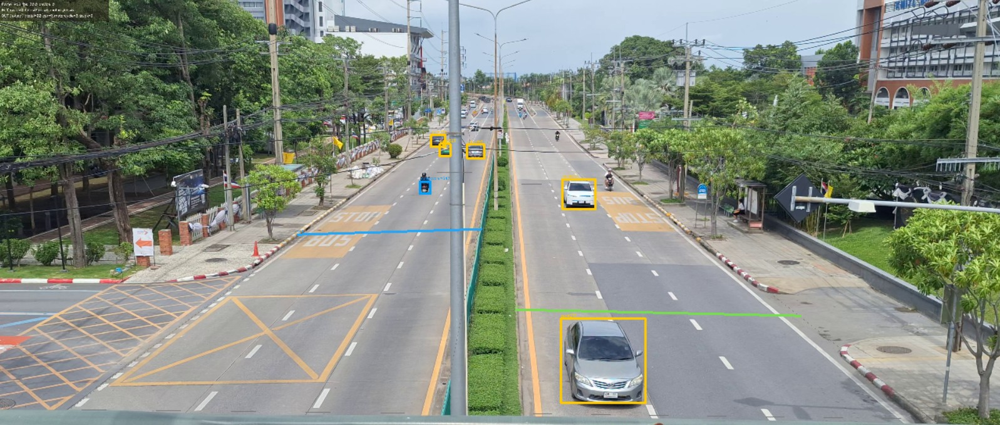
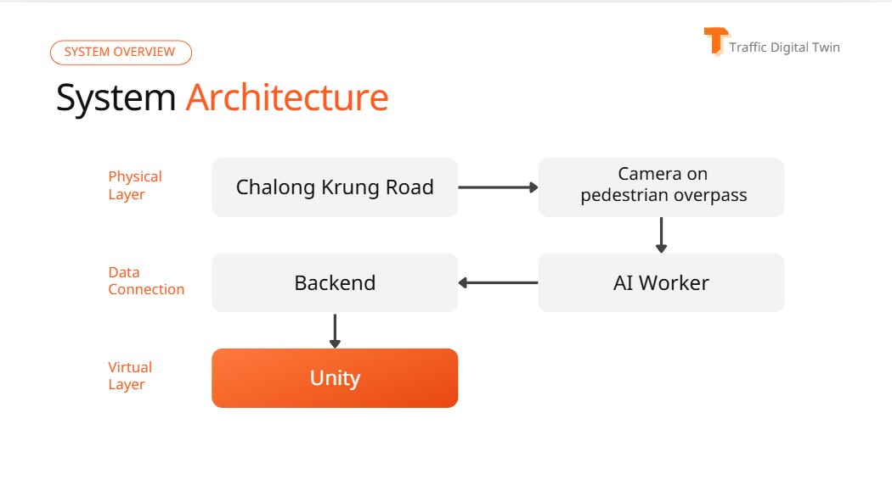
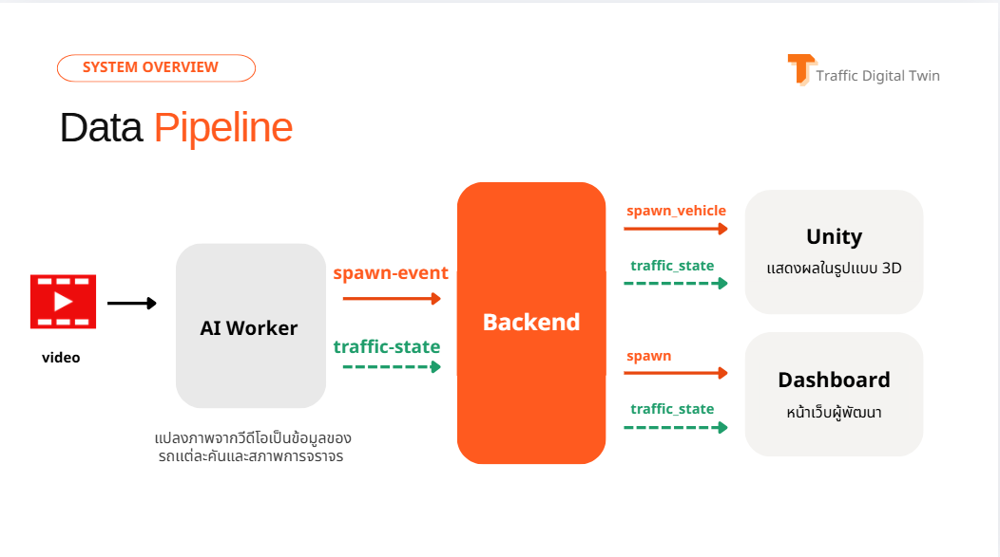

<div align="center">


# Digital Twin Prototype System for Smart Mobility and Environment Simulation

**A traffic digital twin for KMITL — turning CCTV footage the campus already has into a live 3D traffic model, without new sensors.**


**English** · [ไทย](README.th.md)

[▶ Demo](https://www.youtube.com/watch?v=uMzWctl5njQ&feature=youtu.be)

</div>

---

[](https://www.youtube.com/watch?v=uMzWctl5njQ)

## Background & significance

King Mongkut's Institute of Technology Ladkrabang (KMITL) is pursuing a vision of becoming
**The World Master of Innovation** under a Smart University concept — building an environment
that supports quality learning and campus life, with the goal of turning the institute into a
national-scale **Living Lab** (KMITL Smart City). Traffic management around the campus is one
of the central pieces of that goal.

## Problem

- KMITL already has **CCTV cameras** covering campus roads, but today they can only be used to
  **watch** — there's no way to analyze or forecast traffic conditions, or simulate them in 3D.
- There's no existing know-how on campus for building the link between the physical world and
  a virtual one (a Metaverse-style digital twin).

That gap shows up concretely at the vehicle-counting level, too. On Thai roads, cars can be at a
**complete standstill** while motorcycles keep filtering through the gaps — count every vehicle
the same way and the road still looks like it's flowing:

| 20-second window | Cars crossed | Motorcycles crossed |
|---|---|---|
| 2:40–3:00, inbound lane | **2** | **6** |

- **Counted together** → 24 veh/min → system says *Slow Moving* — road appears to flow
- **Counted separately** → 6 veh/min → system says *Standstill* — matches reality

## Objectives

- **Reuse what already exists** — work from the CCTV footage KMITL already has, with no new
  sensor hardware, converting video into 3D vehicle positions.
- **Build a Digital Twin** as a foundation to grow toward the Smart University vision.
- **Design for PDPA compliance from the start** — store only aggregate traffic statistics;
  never record faces or license plates, so no individual can be identified.

## Scope

**Study area** — Chalong Krung Road, from the railway crossing to the motorway interchange.

<p align="center"></p>

**Data handling**

| Stage | What it does |
|---|---|
| Image Object Detection | Detects and tracks vehicles from the CCTV feed |
| Coordinate Mapping | Maps 2D image coordinates to 3D world space so vehicles land correctly on the model |
| Data Handling | Forwards structured data over a real-time API |

**Display** — rendered as a live 3D model through a web browser (WebGL) and desktop (PC).

## Key features

- **Live Traffic Flow** — shows real vehicle movement and density on the 3D model.
- **Traffic State Classification** — classifies and displays the traffic condition per time
  window (e.g. *normal*, *high density*, *slow moving*, *standstill*).

Judged per lane, every 20 seconds, from two measurements:

| | Meaning | Unit |
|---|---|---|
| **Occupancy** | vehicles sitting in the zone — *including stopped ones* | veh / frame |
| **Flow rate** | vehicles crossing the line — *motorcycles excluded* | veh / min |

Counting stopped vehicles is what makes an empty road distinguishable from a jammed one —
both have zero flow.

| State | Condition |
|---|---|
| `normal` | occupancy < 4.0 |
| `standstill` | occupancy ≥ 4.0 **and** flow < 7.5 |
| `slow_moving` | occupancy ≥ 4.0 **and** 7.5 ≤ flow < 32.0 |
| `high_density` | occupancy ≥ 4.0 **and** flow ≥ 32.0 |

> Thresholds are calibrated per camera angle and are **relative**, not veh/km —
> they are not Level of Service (LOS) grades.

## Tech stack

| Module | Stack |
|---|---|
| `ai-worker/` | Python, YOLOv8s, ByteTrack |
| `backend/` | Node.js, Socket.IO 4, Express, TypeScript |
| `unity/` | Unity 6000.4.1f1, C# |

## System architecture

<p align="center"></p>


## Data pipeline

<p align="center"></p>

Two independent data streams:

| Stream | Trigger | Carries |
|---|---|---|
| `spawn-event` | each vehicle crossing the counting line | track id, type, direction |
| `traffic-state` | every 20 seconds | occupancy, flow rates, traffic verdict |

**The backend never alters payloads** — one documented exception trims the vehicle event
to the five fields Unity actually renders.

## Results

Ground truth counted by hand, frame by frame, before looking at any system output.

**Vehicle counting** — 255 real vehicles across 5 clips

| Type | Ground truth | Precision | Recall | F1 |
|---|---|---|---|---|
| Car | 132 | 0.845 | 0.826 | 0.835 |
| **Motorcycle** | 97 | 0.859 | **0.876** | **0.867** |
| Bus / Truck | 26 | 0.500 | 0.615 | 0.552 |
| **Overall** | **255** | **0.808** | **0.824** | **0.816** |

Motorcycles — predicted to be the hardest class — scored highest, which is what the
1280 px input size and 0.35 confidence threshold were tuned for.

**Traffic state classification** — 85% correct (17 of 20 labelled windows), with
**zero** cases of a standstill being reported as normal traffic.

**Motorcycle separation** — across all 20 zone-windows, 3 verdicts changed when
motorcycles were folded back into the flow rate. Two of those were consecutive
standstill windows being masked as *slow moving* — 40 seconds of real congestion
the conventional method never sees.

## Quick start

### Backend

```bash
cd backend
npm install
npm run dev
# → http://localhost:3000        API
# → http://localhost:3000/       live dev dashboard
```

### AI Worker

```bash
cd ai-worker
python -m venv .venv && .venv\Scripts\activate     # Windows
pip install -r requirements.txt
mkdir -p data/input_videos data/output_results data/weights
```

Drop an `.mp4` into `data/input_videos/`, point `video:` at it in a config under
`configs/`, then:

```bash
python -m src.main                      # detect, count, measure
python -m src.main --replay             # ...then classify and print verdicts
python -m src.replay --backend          # send traffic states to the backend
```

With an NVIDIA GPU, reinstall torch matched to your CUDA version — the default
`requirements.txt` pulls a CPU-only build:

```bash
pip uninstall torch torchvision -y
pip install torch torchvision --index-url https://download.pytorch.org/whl/cu128
```

### Unity

Open `unity/Smartflow/` in Unity Hub (installs `6000.4.1f1`). The first launch
resolves `SocketIOUnity` straight from GitHub, so `git` must be on your PATH.
Start the backend, press Play.

## Repository layout

| Path | Stack | Role |
|---|---|---|
| `ai-worker/` | Python 3.11 | Detect → track → count → measure → classify |
| `backend/` | Node.js 20, TypeScript | Validate → count → broadcast over Socket.IO |
| `unity/Smartflow/` | C#, Unity 6000.4 | 3D scene driven by the Intelligent Driver Model |
| `docs/` | Markdown | Architecture, data contract, project status |

Reusable measurement datasets live in `ai-worker/runs/` — each folder holds a config
plus its recorded measurements, so verdicts can be recomputed without re-running YOLO.

## Design notes

**Measurement is kept separate from judgement.** `traffic_state.jsonl` stores only what
was measured; the verdict is attached at send time. Change a threshold and every past
recording can be re-judged in under a second — no re-detection needed. This is what made
the motorcycle-separation experiment possible on identical data.

**Zones are drawn twice per lane.** A tight polygon around the counting line decides what
gets counted; a longer one reaching further up the road measures density, so a queue
backing up stays visible.

```bash
python -m src.calibrate --config configs/event-2.yaml --preview --save preview.png
```

## Status & limitations

Prototype from Project 1. Known boundaries, stated plainly:

- Reads **video files**, not a live RTSP stream
- Coordinate mapping (homography) is **not yet implemented** — positions are not yet
  true 3D world coordinates
- Thresholds are **camera-specific** — a new angle needs recalibration
- `high_density` never appeared in the test footage, so it stays unvalidated
- Data flows **one way** only, which makes this a **digital shadow**, not a full twin
- No environmental sensors yet, despite the project title

Planned next: live CCTV ingest, homography for real-world coordinates, PM 2.5 overlay,
and a feedback path from the virtual side back to the physical one.

---

<div align="center">

Senior Project · Faculty of Information Technology, KMITL
Advisor: Asst. Prof. Dr. Suwit Poomrittigul

**Pochara Sappasate** (นายพชร สรรพเศรษฐ) · 66070295 · pochara.sap@gmail.com
**Thanakrit Kittisurin** (นายธนกฤต กิตติสุรินทร์) · 66070262 · 66070262@kmitl.ac.th

</div>
