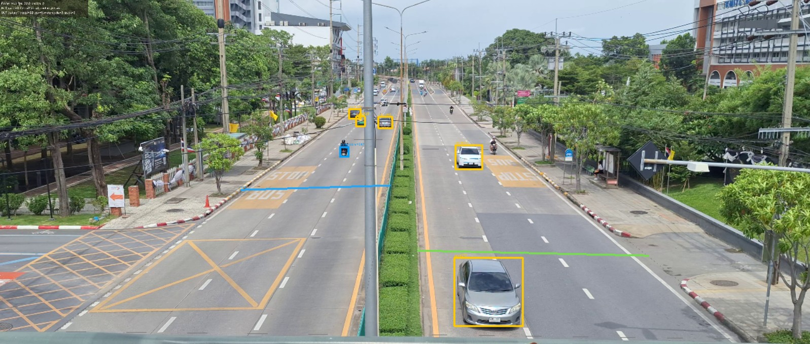
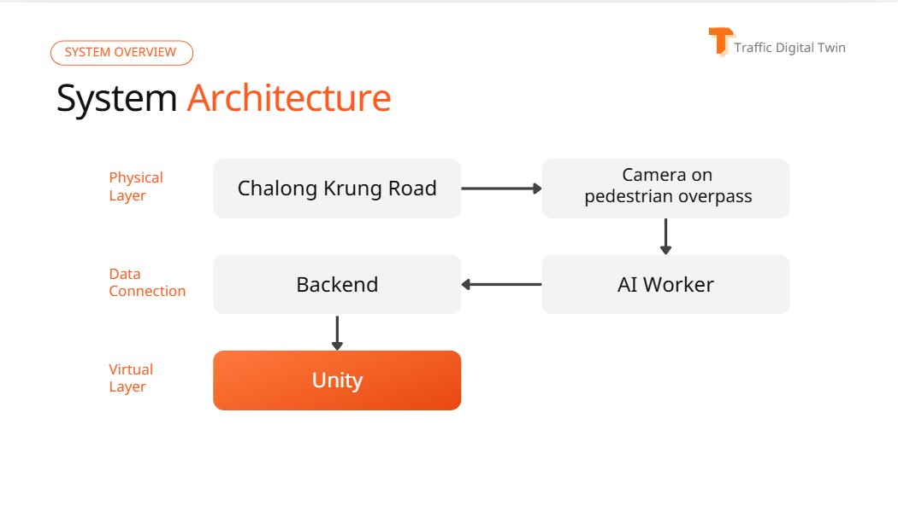
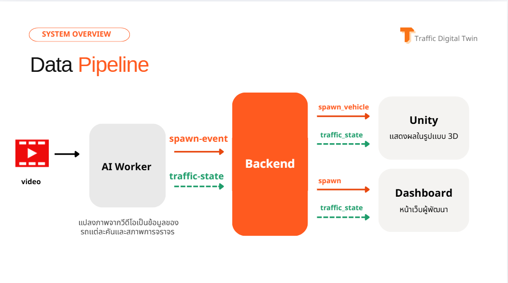

<div align="center">


# Digital Twin for Smart Mobility and Environmental Management

**ระบบต้นแบบแฝดดิจิทัลสำหรับการจำลองการสัญจรและสภาพแวดล้อมอัจฉริยะ**


[English](README.md) · **ไทย**

[▶ Demo](https://www.youtube.com/watch?v=uMzWctl5njQ&feature=youtu.be)

</div>

---

[](https://www.youtube.com/watch?v=uMzWctl5njQ)

## ที่มาและความสำคัญ

สถาบันเทคโนโลยีพระจอมเกล้าเจ้าคุณทหารลาดกระบัง (สจล.) มีวิสัยทัศน์มุ่งสู่การเป็น
**The World Master of Innovation** ภายใต้แนวคิด Smart University เพื่อสร้างสภาพแวดล้อม
ที่เอื้อต่อการเรียนรู้และการใช้ชีวิตอย่างมีคุณภาพ โดยมีเป้าหมายผลักดันพื้นที่สถาบันให้เป็น
**Living Lab** หรือเมืองอัจฉริยะต้นแบบระดับประเทศ (KMITL Smart City) ซึ่งการบริหารจัดการ
การจราจรบริเวณโดยรอบสถาบันถือเป็นหนึ่งในหัวใจสำคัญ

## ปัญหา

- สถาบันมีกล้อง **CCTV** อยู่แล้ว แต่ใช้ได้แค่ **"เฝ้าดู"** ไม่สามารถวิเคราะห์ คาดการณ์
  สภาพจราจร หรือจำลองออกมาในรูปแบบ 3 มิติได้
- ขาดพื้นฐานองค์ความรู้ในการพัฒนากลไกเชื่อมโยงข้อมูลระหว่างโลกจริงและโลกเสมือน (Metaverse)

ปัญหานี้สะท้อนชัดเจนในระดับการนับรถด้วย — บนถนนไทย รถยนต์อาจ**หยุดนิ่งสนิท**
แล้ว แต่มอเตอร์ไซค์ยังมุดผ่านช่องว่างไปได้เรื่อยๆ ถ้านับรวมกัน ถนนจะยังดูเหมือนไหลอยู่:

| หน้าต่าง 20 วินาที | รถยนต์ข้ามเส้น | มอเตอร์ไซค์ข้ามเส้น |
|---|---|---|
| 2:40–3:00 โซนขาเข้า | **2 คัน** | **6 คัน** |

- **นับรวมกัน** → 24 คัน/นาที → ระบบตัดสินว่า *เคลื่อนตัวช้า* — ดูเหมือนถนนยังไหล
- **นับแยก** → 6 คัน/นาที → ระบบตัดสินว่า *หยุดนิ่ง* — ตรงกับความจริง

## วัตถุประสงค์

- **ใช้ข้อมูลที่มีอยู่ให้เป็นประโยชน์** — ใช้กล้อง CCTV ที่มีอยู่ ไม่ต้องลงทุนซื้อเซนเซอร์ใหม่
  แปลงวิดีโอเป็นตำแหน่งรถ 3 มิติ
- **พัฒนา Digital Twin** เพื่อเป็นพื้นฐานต่อยอดไปสู่ Smart University
- **ออกแบบระบบรองรับ PDPA** ตั้งแต่ต้น โดยเก็บเฉพาะข้อมูลสถิติจราจร
  **ไม่บันทึกใบหน้าหรือป้ายทะเบียน** ทำให้ไม่สามารถระบุตัวตนได้

## กรอบการพัฒนา

**พื้นที่ศึกษา** — ถนนฉลองกรุง ช่วงตั้งแต่ทางแยกรถไฟจนถึงมอเตอร์เวย์

<p align="center"></p>

**การจัดการข้อมูล**

| ขั้นตอน | หน้าที่ |
|---|---|
| Image Object Detection | ตรวจจับและติดตามยานพาหนะจากกล้องวงจรปิด |
| Coordinate Mapping | แปลงพิกัดภาพ 2 มิติสู่พื้นที่ 3 มิติ เพื่อระบุตำแหน่งรถลงบนแบบจำลอง |
| Data Handling | ส่งต่อข้อมูลที่มีโครงสร้างผ่านระบบ API แบบเรียลไทม์ |

**การแสดงผล** — แสดงผลแบบจำลอง 3 มิติผ่าน Web Browser (WebGL) และ PC

## ฟีเจอร์หลัก

- **Live Traffic Flow** — แสดงการเคลื่อนที่และความหนาแน่นของยานพาหนะจริงบนโมเดล 3 มิติ
- **Traffic State Classification** — จำแนกและแสดงสถานะสภาพการจราจรตามช่วงเวลา
  (เช่น คล่องตัว หนาแน่น เคลื่อนตัวช้า และติดขัด)

ตัดสินแยกรายฝั่งถนน ทุก 20 วินาที จากค่าที่วัดได้สองตัว

| | หมายถึง | หน่วย |
|---|---|---|
| **Occupancy** | รถที่ค้างอยู่ในกรอบ — *รวมคันที่จอดนิ่ง* | คัน/เฟรม |
| **Flow rate** | รถที่ข้ามเส้นนับ — *ไม่รวมมอเตอร์ไซค์* | คัน/นาที |

การนับรถที่จอดนิ่งด้วยคือสิ่งเดียวที่ทำให้แยก *ถนนว่าง* ออกจาก *รถติดสนิท* ได้
เพราะทั้งสองกรณีมีอัตราการไหลเป็นศูนย์เหมือนกัน

| สถานะ | เงื่อนไข |
|---|---|
| `normal` | occupancy < 4.0 |
| `standstill` | occupancy ≥ 4.0 **และ** flow < 7.5 |
| `slow_moving` | occupancy ≥ 4.0 **และ** 7.5 ≤ flow < 32.0 |
| `high_density` | occupancy ≥ 4.0 **และ** flow ≥ 32.0 |

> ค่าเกณฑ์สอบเทียบเฉพาะมุมกล้องและเป็น**ค่าสัมพัทธ์** ไม่ใช่คันต่อกิโลเมตร
> จึงไม่ใช่ระดับการให้บริการ (LOS)

## Tech stack

| โมดูล | สแตก |
|---|---|
| `ai-worker/` | Python, YOLOv8s, ByteTrack |
| `backend/` | Node.js, Socket.IO 4, Express, TypeScript |
| `unity/` | Unity 6000.4.1f1, C# |

## System Architecture

<p align="center"></p>


## Data Pipeline

<p align="center"></p>

ข้อมูลสองสายที่แยกจากกัน

| สาย | ส่งเมื่อไหร่ | บรรจุอะไร |
|---|---|---|
| `spawn-event` | ทุกครั้งที่รถข้ามเส้นนับ | รหัสประจำตัว ชนิด ทิศทาง |
| `traffic-state` | ทุก 20 วินาที | ความหนาแน่น อัตราการไหล คำตัดสินสภาพจราจร |

**Backend ไม่แก้ไขข้อมูลที่ส่งผ่าน** — มีข้อยกเว้นที่ระบุไว้เพียงกรณีเดียว คือการตัด
เหตุการณ์รายคันให้เหลือห้าฟิลด์ที่ Unity ใช้จริง

## ตัวอย่างผลการทดลอง

ค่าอ้างอิงนับด้วยตาทีละคัน ก่อนดูผลของระบบทุกครั้ง

**ความแม่นยำการนับยานพาหนะ** — 255 คันจริงจาก 5 คลิป

| ชนิด | ค่าจริง | Precision | Recall | F1 |
|---|---|---|---|---|
| รถยนต์ | 132 | 0.845 | 0.826 | 0.835 |
| **มอเตอร์ไซค์** | 97 | 0.859 | **0.876** | **0.867** |
| รถบัส / รถบรรทุก | 26 | 0.500 | 0.615 | 0.552 |
| **รวม** | **255** | **0.808** | **0.824** | **0.816** |

มอเตอร์ไซค์ซึ่งคาดว่าจะตรวจจับยากที่สุด กลับได้คะแนนสูงที่สุด — สอดคล้องกับที่
ปรับขนาดภาพนำเข้าเป็น 1280 พิกเซลและค่าขีดแบ่งความเชื่อมั่น 0.35 มาเพื่อแก้ปัญหานี้โดยเฉพาะ

**ความแม่นยำการจำแนกสภาพจราจร** — ถูกต้อง 85% (17 จาก 20 หน้าต่างที่กำกับไว้)
และ**ไม่มีกรณีใดเลย**ที่สภาวะหยุดนิ่งถูกตัดสินว่าเป็นการจราจรปกติ

**ผลของการแยกมอเตอร์ไซค์** — จากทั้งหมด 20 ค่า คำตัดสินเปลี่ยนไป 3 ค่าเมื่อนำ
มอเตอร์ไซค์กลับเข้าไปรวมในอัตราการไหล โดย 2 ใน 3 เป็นหน้าต่างหยุดนิ่งที่ติดต่อกัน
ถูกกลบเป็น *เคลื่อนตัวช้า* — รวมเป็นรถติดจริง 40 วินาทีที่วิธีนับรวมมองไม่เห็นเลย

## วิธีติดตั้งและรันโปรเจกต์

### Backend

```bash
cd backend
npm install
npm run dev
# → http://localhost:3000        API
# → http://localhost:3000/       หน้าเว็บสำหรับผู้พัฒนา
```

### AI Worker

```bash
cd ai-worker
python -m venv .venv && .venv\Scripts\activate     # Windows
pip install -r requirements.txt
mkdir -p data/input_videos data/output_results data/weights
```

วางไฟล์ `.mp4` ไว้ใน `data/input_videos/` แล้วชี้ `video:` ไปที่ไฟล์นั้นในไฟล์ตั้งค่า
ใต้ `configs/` จากนั้น

```bash
python -m src.main                      # ตรวจจับ นับ วัดค่า
python -m src.main --replay             # ...แล้วตัดสินสถานะพร้อมพิมพ์ผล
python -m src.replay --backend          # ส่งสภาพจราจรไปยัง backend
```

ถ้ามีการ์ดจอ NVIDIA ให้ติดตั้ง torch ใหม่ให้ตรงกับ CUDA ของเครื่อง เพราะ
`requirements.txt` ติดตั้งรุ่นที่ใช้ CPU อย่างเดียว

```bash
pip uninstall torch torchvision -y
pip install torch torchvision --index-url https://download.pytorch.org/whl/cu128
```

### Unity

เปิด `unity/Smartflow/` ผ่าน Unity Hub (จะติดตั้ง `6000.4.1f1` ให้) การเปิดครั้งแรก
จะดึง `SocketIOUnity` จาก GitHub โดยตรง จึงต้องมี `git` อยู่ใน PATH
เปิด backend ไว้แล้วกด Play

## โครงสร้างโปรเจกต์

| โฟลเดอร์ | เทคโนโลยี | หน้าที่ |
|---|---|---|
| `ai-worker/` | Python 3.11 | ตรวจจับ → ติดตาม → นับ → วัด → ตัดสิน |
| `backend/` | Node.js 20, TypeScript | ตรวจสอบ → นับสะสม → กระจายผ่าน Socket.IO |
| `unity/Smartflow/` | C#, Unity 6000.4 | ฉากสามมิติขับเคลื่อนด้วย Intelligent Driver Model |
| `docs/` | Markdown | สถาปัตยกรรม สัญญาข้อมูล ความคืบหน้า |

ชุดข้อมูลผลการวัดที่นำกลับมาใช้ซ้ำได้อยู่ใน `ai-worker/runs/` — แต่ละโฟลเดอร์เก็บ
ไฟล์ตั้งค่าพร้อมผลการวัด จึงตัดสินสถานะใหม่ได้โดยไม่ต้องรัน YOLO ซ้ำ

## แนวคิดการออกแบบ

**แยกการวัดออกจากการตัดสิน** — `traffic_state.jsonl` เก็บเฉพาะสิ่งที่วัดได้
คำตัดสินถูกเติมตอนส่งออกเท่านั้น เปลี่ยนเกณฑ์แล้วนำข้อมูลเดิมมาตัดสินใหม่ได้ในไม่ถึงวินาที
โดยไม่ต้องตรวจจับใหม่ — นี่คือสิ่งที่ทำให้การทดลองแยกมอเตอร์ไซค์ทำบนข้อมูลชุดเดียวกันได้

**วาดกรอบสองชั้นต่อหนึ่งเลน** — กรอบแคบรอบเส้นนับใช้ตัดสินว่าจะนับคันไหน
ส่วนกรอบที่ยื่นไปไกลกว่าใช้วัดความหนาแน่น เพื่อให้เห็นแถวรถที่ต่อคิวอยู่ด้านหลัง

```bash
python -m src.calibrate --config configs/event-2.yaml --preview --save preview.png
```

## สิ่งที่จะพัฒนาต่อ

**01 · เชื่อมต่อกับกล้องวงจรปิดจริงของสถาบัน**
รับสตรีม RTSP จากกล้อง CCTV โดยตรง และแยกโมดูลต่าง ๆ ไปทำงานบนเครื่องหรือเซิร์ฟเวอร์ที่ต่างกัน
เพื่อวัดความหน่วงและเสถียรภาพของระบบภายใต้สภาพเครือข่ายจริง

**02 · ขยายชุดข้อมูลและปรับปรุงความแม่นยำของการนับ**
บันทึกวิดีโอเพิ่มในช่วงเวลาเร่งด่วน เวลากลางคืน และขณะฝนตก โดยเฉพาะให้มีรถบัสและรถบรรทุก
จำนวนมากพอ แล้วนำมาปรับแต่งโมเดลจำลอง

**03 · แปลงพิกัดภาพสู่พิกัดจริงบนพื้นถนน**
ใช้การแปลงโฮโมกราฟี (Homography) จากจุดอ้างอิงที่ทราบตำแหน่งจริง เพื่อให้ได้ตำแหน่งและความเร็ว
ของยานพาหนะเป็นหน่วยเมตร ซึ่งจะช่วยให้ตำแหน่งในฉากสามมิติตรงกับความเป็นจริง

**04 · บูรณาการข้อมูลสภาพแวดล้อม**
เชื่อมต่อเซนเซอร์ Smart City เช่น เครื่องวัดฝุ่น PM 2.5 และแสดงผลซ้อนบนฉากสามมิติ

**05 · ยกระดับสู่แฝดดิจิทัลเต็มรูปแบบ**
ให้ฝั่งเสมือนสามารถจำลองสถานการณ์ล่วงหน้า (What-If Simulation) และส่งข้อเสนอแนะหรือคำสั่งกลับ
ไปยังโลกจริง

---

<div align="center">

โครงงานวิศวกรรม · คณะเทคโนโลยีสารสนเทศ สจล.
อาจารย์ที่ปรึกษา: ผศ. ดร. สุวิทย์ ภูมิฤทธิกุล

**นายพชร สรรพเศรษฐ** Pochara Sappasate · 66070295 · pochara.sap@gmail.com
**นายธนกฤต กิตติสุรินทร์** Thanakrit Kittisurin · 66070262 · 66070262@kmitl.ac.th

</div>
